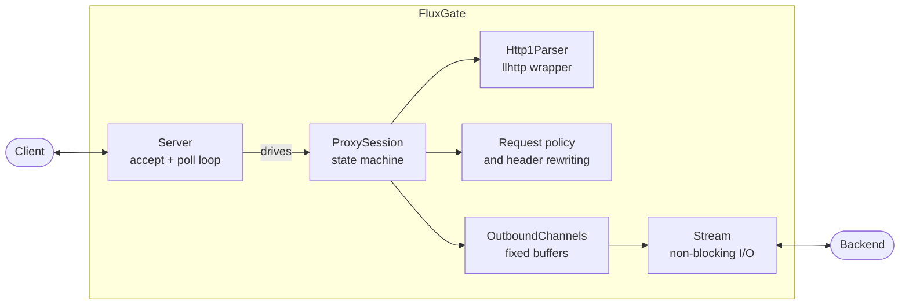

# FluxGate

An HTTP/1.1 reverse proxy written in modern C++20 for Linux, built to explore how
infrastructure such as NGINX, HAProxy and Envoy works internally. For real deployments,
use one of those. This project exists to understand and measure the design choices.

> **Status: Milestone 1 of 7 (foundation).** FluxGate forwards to a single backend and
> serves **one connection at a time**, so it is not production-ready and must not face
> untrusted traffic. This README describes only implemented behaviour, and will only
> quote benchmark numbers produced by scripts in this repository.

## What works today

- Forwarding to one configured backend, with non-blocking sockets throughout
- Full-duplex relaying, correct under arbitrary fragmentation and partial writes
- Backpressure with fixed per-connection memory
- Strict HTTP/1.1 framing through llhttp, refusing conflicting or malformed framing
- Response streaming with `Content-Length`, chunked and close-delimited bodies
- `HEAD`, 204/304, interim 1xx responses, and `Expect: 100-continue`
- Hop-by-hop header removal and client provenance header replacement
- Separate timeouts for head, connect, response, idle and whole exchange
- YAML configuration, fully validated before any socket opens
- Structured JSON access logs that omit query strings
- Prompt, resource-safe exit on SIGTERM and SIGINT (in-flight work is cut off)

## Current limitations

| Limitation | Behaviour | Resolved in |
| --- | --- | --- |
| One connection at a time | Others wait in the backlog | M2 |
| One request per connection | `Connection: close` is always sent | M3 |
| No chunked requests | 501 | M3 |
| One backend, no health checks or pooling | | M4 |
| No metrics; shutdown does not drain | | M5 |
| No TLS | | M6 |
| HTTP/1.1 only, no `CONNECT`, no upgrades | 505, 501, `Upgrade` removed | Not scheduled |

The full list is in [docs/roadmap.md](docs/roadmap.md), and known security gaps are in
[docs/security.md](docs/security.md).

## Architecture



`ProxySession` never waits. An event source calls it, and it returns what it needs next.
Today that source is a `poll()` loop; Milestone 2 swaps in epoll without changing the
session. See [docs/architecture.md](docs/architecture.md) and
[docs/design-decisions.md](docs/design-decisions.md).

## Build

Requires Linux, GCC 13 and Python 3. Everything else, including CMake, Ninja, Conan and
the clang tools, is installed into a local `.venv` with exact versions, and no root
access is needed.

```bash
scripts/bootstrap.sh release              # Tools plus locked dependencies
.venv/bin/cmake --preset release
.venv/bin/cmake --build --preset release
```

Presets are `debug`, `release`, `asan` (AddressSanitizer with UBSan) and `tsan`.

## Run

```bash
python3 examples/backend-server/server.py --port 9000 &
build/release/fluxgate --config config/proxy.yaml

curl -i http://127.0.0.1:8080/hello
```

Or with Docker, running the proxy in front of the same example backend:

```bash
docker compose up --build
```

## Configure

The backend is set in [config/proxy.yaml](config/proxy.yaml), which also documents every
option and default:

```yaml
upstream:
  host: 127.0.0.1
  port: 9000
```

Validate a file without starting the proxy:

```bash
build/release/fluxgate --config config/proxy.yaml --check-config
```

Unknown keys, duplicate keys, bad ranges and contradictory timeouts are all rejected, with
every problem listed at once. Exit status is 2 for configuration errors and 1 for runtime
failures.

## Logs

One JSON object per line goes to stdout:

```json
{"ts":"2026-11-05T00:36:10.783-05:00","level":"info","event":"access","client":"127.0.0.1","method":"GET","path":"/hello","status":200,"outcome":"completed","detail":"","bytes_in":113,"bytes_out":474,"duration_us":811}
```

Prometheus metrics arrive in Milestone 5.

## Test

```bash
scripts/bootstrap.sh debug
.venv/bin/cmake --preset debug
.venv/bin/cmake --build --preset debug
.venv/bin/ctest --preset debug
```

There are unit tests, including a suite that scripts every short write and `EAGAIN`, and
black-box pytest suites that drive the real binary over real sockets. To run those directly:

```bash
FLUXGATE_BIN=$PWD/build/debug/fluxgate .venv/bin/pytest tests/integration
```

For sanitizers, use the `asan` or `tsan` preset. GCC 13's TSan runtime fails on kernels with
high-entropy ASLR, so prefix its build and test commands with `setarch "$(uname -m)" -R`.

Static checks are `scripts/check.sh debug`, which runs clang-format and clang-tidy.

## Benchmarks

None yet. Reproducible load tests and comparisons arrive in Milestone 7, and no performance
claims are made until then.

## Roadmap

1. **Foundation** (current)
2. Event-driven networking with epoll
3. HTTP/1.1 correctness: persistent connections, chunked requests, pipelining
4. Load balancing, health checks and connection pooling
5. Metrics, request IDs, graceful shutdown and multi-worker operation
6. TLS and security hardening
7. Performance engineering

See [docs/roadmap.md](docs/roadmap.md) for status at feature level.

## License

MIT
