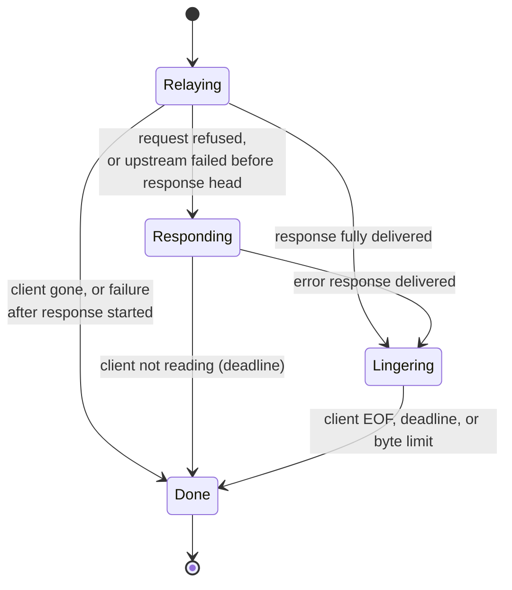

# Architecture

This describes what exists today, at the end of Milestone 1, and marks where later
milestones extend it. [roadmap.md](roadmap.md) has the status of each capability.

## Components

| Layer | Location | Responsibility |
| --- | --- | --- |
| `net` | `include/fluxgate/net` | RAII descriptors, addresses, sockets, the `Stream` interface |
| `core` | `include/fluxgate/core` | The fixed-capacity `ByteBuffer` |
| `http` | `include/fluxgate/http` | The `Http1Parser` llhttp wrapper; request policy and header rewriting |
| `proxy` | `include/fluxgate/proxy` | `ProxySession`, `OutboundChannel`, `Server` |
| `config` | `include/fluxgate/config` | YAML parsing and validation |
| `log` | `include/fluxgate/log` | Structured JSON logging |

Dependencies run strictly downward. `http` knows nothing about sockets, and `proxy` is
the only layer that combines protocol and I/O.

## The central design: a session that never waits

`ProxySession` is a non-blocking state machine for one client connection. It has no
loop and never calls `poll`. An event source calls `advance()`, which moves all the
data it can and returns a `Wait` value saying what to wait for:

```cpp
struct Wait {
  Interest client;      // read / write
  Interest upstream;    // read / write
  std::optional<Clock::time_point> deadline;
};
```

`Server` is that event source today: one `poll()` loop serving one connection at a
time. Milestone 2 replaces it with an epoll loop while the session stays as it is,
which is why concurrency could be deferred without writing blocking code to throw away.

This shape also makes the session testable. The clock is a parameter, and I/O goes
through `Stream`, so `tests/unit/session_test.cpp` can script every short write and
`EAGAIN` and move time forward without sleeping.

## Connection state machine

A session has an overall phase, and within `Relaying` the two directions progress
independently.



| Sub-state | Values |
| --- | --- |
| `RequestState` | `ReadingHead` → `ReadingBody` → `Complete` |
| `ResponseState` | `ReadingHead` → `RelayingBody` → `Complete` |
| `UpstreamState` | `None` → `Connecting` → `Connected` → `None` |

The directions must be independent. An upstream may respond before it has read the
whole request body. A proxy that finished writing the request before reading the
response would deadlock once both sides' buffers filled.

## Request lifecycle

1. `Server` accepts a socket and creates a session with the head deadline set.
2. Client bytes land in the `to_upstream_` buffer. The parser consumes them incrementally,
   copying head fields into a `MessageHead`, so the head may span any number of reads.
3. On `HeadComplete`, `validate_request` applies policy. A refusal happens here, before any
   upstream contact.
4. The head is re-rendered with hop-by-hop and provenance headers replaced, and a
   non-blocking connect starts.
5. Writability ends the connect; `SO_ERROR` gives the result. The head and any validated
   body bytes are then sent, and body bytes keep flowing as they arrive.
6. Response bytes follow the same path in the other direction. The status line and headers
   are re-rendered; body bytes are relayed untouched.
7. Once the response is complete and flushed, the upstream is closed and the client is
   half-closed, then drained briefly (`Lingering`) so that the close cannot send RST.

## Event model and I/O

`poll()` is level-triggered, and the session is written for that: it derives its interest
from its state, and attempts its operations on each `advance()`, treating readiness only as
a hint. Milestone 2 must make the same choice explicitly. Level-triggered epoll carries
over directly, and edge-triggered would additionally require draining to `EAGAIN`.

`advance()` is limited to 16 passes, so an always-ready peer cannot starve deadline checks.
Unfinished work shows up in the returned interest, so the next wait returns at once.

## Threading model

There is one thread. Blocking work (`getaddrinfo`, config loading) happens only at startup.
The session keeps no global state, so sessions can later be pinned to worker threads
without shared ownership of connections. Signals are blocked and read through a `signalfd`,
so no application code ever runs in signal-handler context.

## Buffer ownership and memory

Each session owns two `OutboundChannel`s, each with one `ByteBuffer` of `io_buffer_bytes`
allocated once. A channel's buffer is also the receive buffer for the opposite peer, so
body bytes are read directly into it and never copied in user space.

```text
[ validated: safe to send ][ unvalidated: parser has not seen these ]
```

Only the validated region is ever written. This is the code-level form of the rule that
nothing reaches a peer until the parser has placed it inside the current message. Bytes
beyond the end of a message are dropped, never validated.

Memory per connection is bounded by two buffers plus one rendered head per direction, and
each head is limited by `max_header_bytes` and `max_headers`. Head parsing allocates; that
is a known cost for later optimisation, not a correctness concern.

## Backpressure

A full buffer removes read interest on the source peer. TCP flow control then carries the
pressure back to the sender, without any explicit signalling. `test_large_response_survives_slow_small_window_reader`
relays 40 MiB to a stalled client and asserts that proxy memory stays near its baseline.

## Deadlines

`Wait::deadline` is the earliest applicable of the following:

| Timeout | Runs from | Extended by progress | On expiry |
| --- | --- | --- | --- |
| `request_header` | Accept | No, which is what defeats Slowloris | 408 |
| `connect` | Connect start | No | 504 |
| `response_header` | Request fully sent | No | 504 |
| `idle` | Last byte moved | Yes | 408 or 504 by who is stalled; RST if the response started |
| `exchange` | Accept | No | As for `idle` |
| linger (1 s, fixed) | Response delivered | No | Close |

Idle does not apply while awaiting the response head, as silence is normal then.

## Error handling

Syscall outcomes are normalised by `TcpStream` into `IoStatus`: `EINTR` is retried, and
`EAGAIN` becomes `WouldBlock`. `SIGPIPE` cannot occur on sockets because of `MSG_NOSIGNAL`.

| Event | Client sees |
| --- | --- |
| Malformed request | 400 |
| Oversized head or too many headers | 431 |
| Declared body over limit | 413 |
| Unsupported feature | 501 or 505 |
| Connect failure or refused | 502 |
| Connect or response timeout | 504 |
| Invalid or absent upstream response | 502 |
| Upstream fails after response started | Validated bytes, then RST |
| Request write fails | Nothing yet: any response already sent by the upstream is still read and delivered |

Once a status line has gone out, a status code can no longer report failure. RST is then
the one remaining signal, and the only one a client reading a close-delimited body can see.

## Shutdown

SIGINT or SIGTERM ends `run()` and aborts any session in progress, so an in-flight exchange
is cut off. Graceful draining with a deadline is Milestone 5. Resources are released by RAII,
and the exit status is 0.
